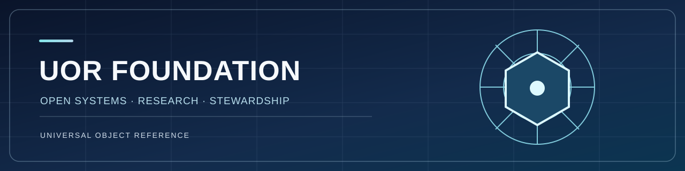

# UOR Foundation

The UOR Foundation stewards the Universal Object Reference (UOR) framework and
supports related open-source projects.

The links below are starting points, not claims that every project is released,
certified, or production-ready. Each repository defines its own current
capabilities, limitations, and verification evidence.

## Contents

- [Technical repositories](#technical-repositories)
  - [Framework and modeling](#framework-and-modeling)
  - [Start building](#start-building)
- [Governance and participation](#governance-and-participation)

## Technical repositories

### Framework and modeling

- [uor-framework](https://github.com/UOR-Foundation/uor-framework)
- [prism](https://github.com/UOR-Foundation/prism)
- [lexlean](https://github.com/UOR-Foundation/lexlean)
- [prismpm](https://github.com/UOR-Foundation/prismpm)

### Start building

- [template](https://github.com/UOR-Foundation/template)
- [UORust](https://github.com/UOR-Foundation/UORust)
- [uor-addr](https://github.com/UOR-Foundation/uor-addr)

## Governance and participation

Foundation policies and contributor instructions are maintained in the linked
documents.

- [Contributor guide](https://github.com/UOR-Foundation/.github/blob/main/CONTRIBUTING.md)
- [Governance framework](https://github.com/UOR-Foundation/.github/blob/main/governance/GOVERNANCE.md)
- [Repository standards](https://github.com/UOR-Foundation/.github/blob/main/STANDARDS.md)
- [Project lifecycle](https://github.com/UOR-Foundation/.github/blob/main/toc/README.md)
- [Security reporting](https://github.com/UOR-Foundation/.github/blob/main/SECURITY.md)
- [Community model](https://github.com/UOR-Foundation/community)
